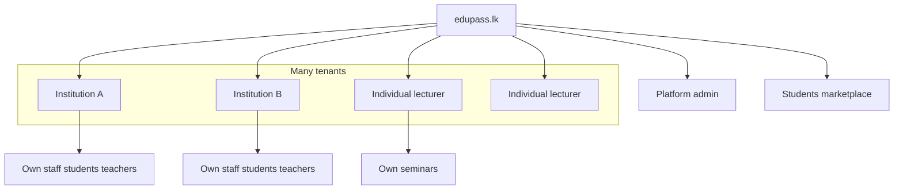

# 01 — Product vision

## Mission

**edupass.lk** is a **multi-tenant** education platform for Sri Lanka’s O/L and A/L market. Many institutions and individual lecturers run their own isolated workspaces on one product. Two features sell on top of that: **Seminar Ops** and **Institute Management**. EduPass earns via **platform billing** (subscription plans + per-ticket commission) — separate from institute tuition or ticket face value.

## Multi-tenant platform (core)

| Who registers | What they get |
|---|---|
| **Institution** | Own tenant: employees/logins, students, teachers/lecturers, optional Institute Management + seminars |
| **Individual lecturer / teacher** | Own tenant (solo org): publish seminars, check-in, payouts — **no** full institute suite unless they later upgrade |
| **Student** | Browse all public seminars; buy tickets; enroll only where an institute invites them |
| **Platform admin** | System console: tenants, plans, fee %, CMS, slip overrides, global settings |

**Hard rule:** Tenant A never sees Tenant B’s roster, fees, staff, or unpublished data. Public catalogue only shows published seminars.

## Two products (do not confuse)

| Product | Who uses it | What it is | What it is *not* |
|---|---|---|---|
| **A — Seminar Ops** | Institutions *and* individual lecturers | Catalogue, tickets, bank checkout, QR, **attendance every seminar** | Not monthly class ops |
| **B — Institute Management** | Institutions (subscription) | Staff, batches, roster, class attendance, **tuition** fee collection | Not required to sell seminars |

### Packaging

1. Individual lecturer → Seminar Ops only (pay-as-you-go platform %).
2. Institution can enable Seminar Ops, Institute Management, or both (plan-gated).
3. Institute Management UI never appears on a seminars-only / individual tenant.
4. Domain language stays split: Ticket check-in ≠ class AttendanceRecord; student Order ≠ tuition Invoice; **platform subscription/commission ≠ tuition**.

## Platform billing (EduPass revenue)

See full detail in [12-platform-billing-and-tenancy.md](12-platform-billing-and-tenancy.md).

| Seller type | How EduPass charges | Notes |
|---|---|---|
| **Institution** (esp. Institute Management) | **Plans:** Free (testing) → Premium → Platinum (names/limits editable by platform admin) | Plan unlocks seats, batches, staff caps, features |
| **Individual lecturer** (seminars) | **Pay-as-you-go:** % of each ticket (e.g. 5–6%), **changeable in admin** | Also apply to seminar sales where plan does not waive commission |
| **Institution seminar sales** | Commission and/or plan inclusion — configured per plan in admin | Default: % applies unless plan says “0% platform fee on tickets” |

Student still pays ticket price / tuition to the seller via bank slip. Platform fee is EduPass’s cut or subscription — tracked separately.

## Three admin surfaces

| Panel | Route prefix (target) | Actor |
|---|---|---|
| **Platform admin** | `/admin/*` | System operators — plans, global ticket %, tenants, CMS, global slips/refunds, feature flags |
| **Institution admin** | `/org/*` or `/organiser/*` | Institution owners/admins — their staff, students, classes, seminars, bank accounts, slip approve for *their* sales |
| **Lecturer / individual panel** | `/organiser/*` (solo) or `/lecturer/*` | Individual sellers + employed teachers (scoped) — own seminars, check-in, earnings; employed teachers: assigned classes only |

One SPA shell; nav and data scope follow membership + tenant type.

## Personas

| Persona | Goals |
|---|---|
| Student | Discover seminars across the marketplace; tickets; optional class portal |
| Individual lecturer | Register alone; post seminars; collect via bank slip; pay platform % |
| Institution admin | Run isolated school instance; staff; optional classes + seminars |
| Employed teacher | Mark class roll / teach assigned seminars inside one institution |
| Gate scanner | QR admit |
| Platform admin | Configure plans, %, approve edge cases, CMS |

## Outcomes by product

**Seminar Ops:** multi-seller catalogue; bank deposit checkout; slip approve by seller (or platform override); QR attendance every seminar; card/PayHere disabled until finance stage.

**Institute Management:** per-institution staff/students/batches/attendance/tuition fees; gated by active plan (Free = testing limits).

## Success metrics

- Second institution can onboard without touching the first’s data.
- Individual lecturer publishes and sells a seminar without institute modules.
- Platform admin changes ticket commission % → next checkout uses new rate.
- Free-plan institute hits a clear upgrade wall (e.g. batch cap) without breaking seminars-only sellers.
- Gate check-in &lt; 2s; no cross-tenant ticket admit.

## Non-goals (near term)

- Live PayHere (stub/disabled).
- Full LMS / seat maps / multi-currency / native apps.
- Automatic bank payouts to lecturers (manual settlement + ledger first).

## Brand & UX

- Keep Vite visual system; evolve routes.
- Panels must feel distinct: platform vs institution vs individual — without forking three codebases.
- Every money and attendance action auditable server-side.
