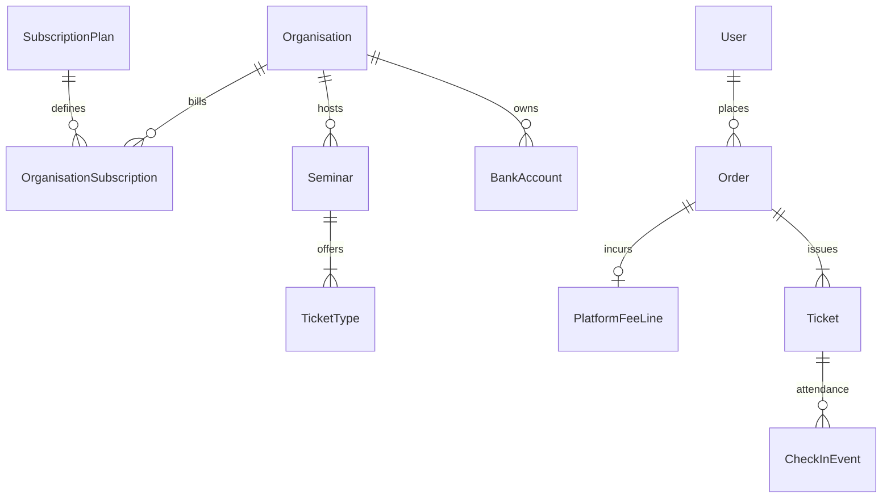

# 03 — Domain model

Canonical entities for Nest + Prisma. Keep **Seminar Ops**, **Institute Management**, and **Platform billing** conceptually separate.

## Shared / platform layer

| Entity | Purpose |
|---|---|
| **User** | Login identity |
| **StudentProfile** | Exam year, school, district, stream |
| **Organisation** | **Tenant** — `INSTITUTE` \| `INDIVIDUAL_LECTURER` \| `INDEPENDENT` \| `SCHOOL_SOCIETY` |
| **OrganisationEntitlement** | Product flags `seminars` \| `institute` (often derived from plan) |
| **StaffMembership** | User ↔ Organisation: `owner \| admin \| teacher \| cashier \| scanner` |
| **PlatformAdmin** | Global system role |
| **BankAccount** | Tenant deposit instructions **or** EduPass platform account (for plan invoices) |
| **PaymentSlip** | Proof for seminar order, tuition fee, **or** platform subscription payment |
| **PlatformSettings** | CMS + `ticketCommissionPercent`, feature flags |
| **SubscriptionPlan** | Free / Premium / Platinum (+ admin-defined) — see doc 12 |
| **OrganisationSubscription** | Tenant’s current plan + period + status |
| **PlatformFeeLine** | Commission row snapshotted on seminar Order |
| **PlatformInvoice** | Optional: Premium/Platinum subscription charge to institution |

Students can buy any public seminar and enroll only in institutes that roster them.

## Tenant kinds

| Kind | Isolation | Products |
|---|---|---|
| Institution | Full staff + students + classes + optional seminars | Plan-gated |
| Individual lecturer | Solo owner (+ optional scanner helper) | Seminars + pay-as-you-go % |
| Many of each | Separate `organisationId` worlds on one DB | — |

## Product A — Seminar Ops

| Entity | Notes |
|---|---|
| **Category** | Taxonomy |
| **LecturerProfile** | Public persona; may equal individual org owner or employed teacher |
| **Seminar** | Belongs to **one** `organisationId`; physical/online/hybrid |
| **TicketType** | Price, capacity, sold |
| **Order** | Student purchase; stores `commissionPercentSnapshot`, `platformFeeAmount` |
| **Payment** | Bank path statuses |
| **Ticket** | QR code; valid after pay confirm |
| **CheckInEvent** | Seminar attendance audit |
| **RefundRequest** | |
| **Banner / Faq / Announcement** | CMS |

### Every seminar has attendance

`checkInMode`: `qr_gate` \| `join_link` \| `both`. Tickets valid only after payment confirmed. Single-use QR.

## Product B — Institute Management

Requires institute entitlement / plan feature.

| Entity | Notes |
|---|---|
| **Programme**, **Batch**, **ScheduleSlot**, **ClassSession** | Classes |
| **Enrollment**, **AttendanceRecord** | Roster + class roll (**≠** CheckInEvent) |
| **TuitionFeePlan**, **TuitionInvoice**, **TuitionPayment** | Prefer `Tuition*` naming in new code to avoid confusion with **platform** fees — maps from earlier FeePlan/Invoice/FeePayment |
| **RosterImportJob** | CSV |

## Payments (student → seller)

| Method | MVP |
|---|---|
| `bank_transfer` / `bank_deposit` | Live + slip |
| `cash` | Institute tuition cashier only |
| `card` | Disabled (PayHere later) |

Order: `awaiting_slip` → `under_review` → `paid` (+ PlatformFeeLine). Reject → re-upload.

## Platform billing objects

See [12-platform-billing-and-tenancy.md](12-platform-billing-and-tenancy.md).

| Entity | Role |
|---|---|
| SubscriptionPlan | Free / Premium / Platinum definitions |
| OrganisationSubscription | Active plan for institution |
| PlatformFeeLine | % of ticket sale |
| PlatformInvoice + slip | Institution pays EduPass for paid plans |
| PlatformSettings.ticketCommissionPercent | Global default % |

## Cross-cutting rules

1. **Tenant isolation** on every non-public query.
2. **Entitlement + plan limits** enforced server-side.
3. **Attendance split:** CheckInEvent ≠ AttendanceRecord.
4. **Money split:** Order ≠ TuitionInvoice ≠ PlatformInvoice/FeeLine.
5. **Commission snapshot** on Order at checkout.
6. **Inventory** increments on payment confirm.
7. **Idempotency** on checkout, slips, check-in, approve.

## Mapping from current FE

| FE today | Becomes |
|---|---|
| `Organiser` | Organisation (+ type individual vs institute) |
| `Student` | User + StudentProfile |
| Platform booking fee % in settings | Split: display booking fee vs **platform commission** (doc 12) |
| FeePlan (institute) | TuitionFeePlan — not SubscriptionPlan |
