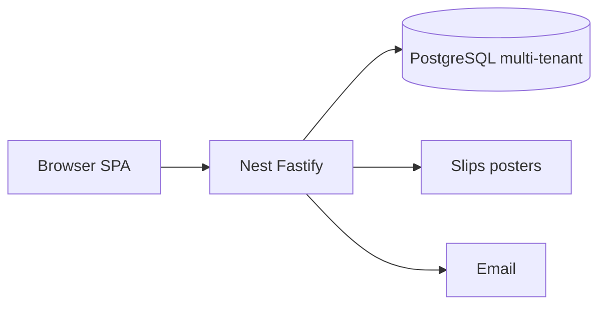

# 04 — Architecture

## Monorepo

```
edupass.lk/
├── frontend/     # Vite React SPA — student + 3 admin surfaces
├── backend/      # NestJS + Fastify API
├── docs/
└── package.json
```

## System context



PayHere out of runtime until finance stage.

## Multi-tenant isolation

- Row-level: `organisationId` on tenant-owned tables.
- Guards: JWT → membership → `OrgScope` → `RequiresEntitlement` → `RequiresPlanFeature` / limit checks.
- Public catalogue: explicit “published seminars” query only.
- Platform admin: bypass tenant scope with audit log.

## Backend modules

| Module | Scope |
|---|---|
| Health, Prisma, Config | Platform |
| Auth, Users | Platform |
| Organisations | Tenants, staff, bank accounts |
| BillingModule | **SubscriptionPlan, subscriptions, PlatformFeeLine, commission settings** |
| Catalogue, Seminars, Checkout, Tickets, CheckIn | Seminar Ops |
| Payments | Slips (order / tuition / platform invoice) + PayHere stub |
| Refunds, Cms, Admin | Platform admin |
| Institute, Fees (tuition) | Institute Management |
| Notifications | Platform |

## Frontend surfaces (one app)

| Surface | Who | Nav source |
|---|---|---|
| Public + student | Students | Existing public + `/student` |
| Institution panel | Org admins/staff | Entitlements + plan features |
| Individual lecturer panel | Solo sellers | Seminars + earnings + fee % display |
| Platform admin | System | `/admin` plans, %, tenants, CMS |

`DashboardLayout.tsx` (or split layouts) switches nav from `/auth/me` → `actorContext`.

## Security

- JWT + refresh; rate limits; HMAC QR; private slip storage.
- Plan limit and commission calculation **only** on server.
- Individual cannot call `/institute/*`.

## Deployment

FE Netlify/Vercel; BE Node host; Neon Postgres.  
Secrets: `DATABASE_URL`, `JWT_*`, `QR_HMAC_SECRET`, `CORS_ORIGINS`, `PAYHERE_ENABLED=false`. No PayHere keys required for MVP.

## Decisions

| Decision | Choice |
|---|---|
| Tenancy | Single DB, `organisationId` discriminator |
| Individual lecturers | First-class tenant type, not “fake institute” |
| Platform revenue | Plans + ticket % (doc 12) |
| Tuition vs platform fee | Separate modules/names |
| Student money MVP | Bank slip |
| Card | Disabled until Phase F |
