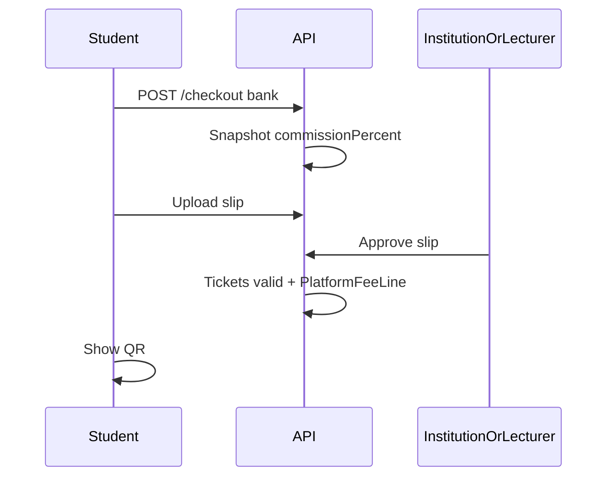

# 06 — User flows

## Flow A — Individual lecturer: register → sell seminar → attendance

1. Register as lecturer → solo tenant + seminars entitlement + global ticket %.
2. Set bank account; create seminar + ticket types + `checkInMode`.
3. Publish → public catalogue.
4. Student checkout **bank transfer** (card disabled) → upload slip.
5. Lecturer approves slip → tickets valid; **PlatformFeeLine** recorded at snapshotted %.
6. Event day: check-in QR (seminar attendance).
7. Earnings view: gross − platform fee. No institute nav.

## Flow B — Institution: Free plan → classes (and optional seminars)

1. Register as institution → Free (testing) subscription.
2. Invite staff/teachers; add students; create batches within Free limits.
3. Hit limit → upgrade CTA → Premium/Platinum → pay EduPass via bank slip → admin/system confirms → limits lift.
4. Optional: publish seminars under same tenant; commission per plan rules.
5. Class attendance uses AttendanceRecord; seminar gate uses CheckInEvent.

## Flow C — Student buys ticket (any seller)

## Flow D — Platform admin configures commercial model

1. Edit plans (Free/Premium/Platinum limits & prices).
2. Set global `ticketCommissionPercent` (e.g. 5 → 6).
3. Assign plan to an institution; view revenue fee lines.
4. CMS + refund overrides as today.

## Flow E — Employed teacher inside institution

1. Institution admin invites teacher membership.
2. Teacher logs in → scoped panel: assigned batches / seminars only.
3. Cannot change org billing or platform settings.

## Flow F — Refund

Student requests → seller/platform approves → void tickets, restore seats, adjust PlatformFeeLine (reduce/cancel fee on full refund). Settlement to student offline until PayHere.

## Error UX

- Plan limit: clear upgrade message.
- Slip under review: explicit status.
- Card: disabled “Coming soon”.
- Check-in: large pass/fail; never cross-tenant.
