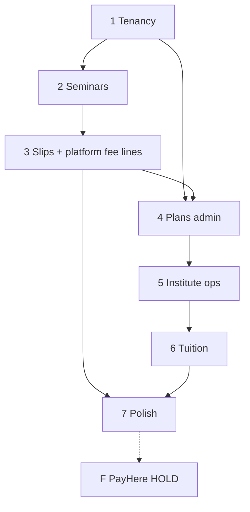

# 09 — Delivery roadmap

Multi-tenant SaaS build. **Bank slips live; PayHere HOLD.** Platform billing (plans + ticket %) is in-scope — not deferred with PayHere.

## Phase 0 — Docs

- [x] Vision, tenancy/billing (doc 12), domain, API, flows, FE/BE, playbook, tracker

## Phase 1 — Foundation + tenancy

- Prisma, auth, register **student / institution / lecturer**
- Organisation kinds, memberships, Free plan seed, global commission setting
- FE login + three register entry points + actor-aware nav

**Exit:** Two institutions isolated; individual lecturer has no institute nav.

## Phase 2 — Seminar Ops + attendance

- Catalogue, CRUD, checkInMode, checkout bank order + commission snapshot
- Check-in + attendees
- FE seller + student ticket UX

**Exit:** Lecturer sells (manual paid ok) → QR → admit once.

## Phase 3 — Slips, refunds, platform fee lines

- Slip upload/approve; tickets on approve; **PlatformFeeLine**
- Earnings API; refunds adjust fees
- Card disabled; PayHere stub

**Exit:** Full bank path; admin can change % and see fee revenue.

## Phase 4 — Platform plans admin + institute upgrades

- Admin CRUD Free/Premium/Platinum
- Institution usage meter + upgrade + PlatformInvoice slip to EduPass
- PlanLimitService enforcement

**Exit:** Free institute blocked at cap; upgrade unlocks.

## Phase 5 — Institute Management

- Staff, batches, roster, sessions, class attendance (entitlement + plan)

**Exit:** Institution runs classes without breaking lecturer tenants.

## Phase 6 — Tuition fees

- Tuition plans/invoices/payments (cash + slip) — **not** platform billing

## Phase 7 — Polish

- Stream join, camera QR, reports, Playwright, mocks off

## Phase F — PayHere (HOLD)

- Card + gateway; optional auto plan billing — wait for owner brief

## Definition of done (pre-PayHere)

- Multi-institution + individual lecturers isolated  
- Seminar attendance everywhere  
- Platform plans + configurable ticket %  
- Bank path only for student payments  
- Three admin surfaces usable  
- Tuition ≠ platform fee in UI and schema  
