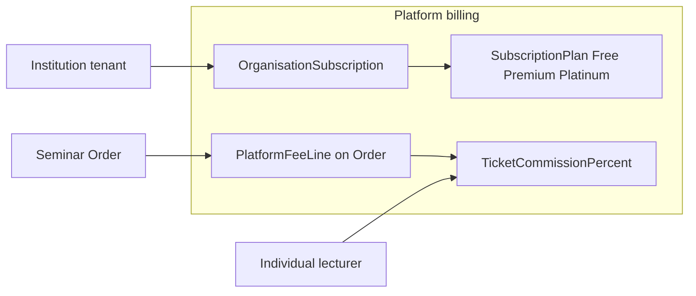

# 12 — Platform billing and tenancy

This doc is **EduPass’s own commercial model** (what the platform charges tenants).  
It is **not** institute tuition (`FeePlan` / `Invoice`) and **not** the student ticket face price.

## Tenant model

| Tenant kind | `Organisation.type` | Typical products | Platform commercial |
|---|---|---|---|
| Institution | `INSTITUTE` (or school society) | Institute Management ± Seminar Ops | **Subscription plan** (+ optional ticket % per plan rules) |
| Individual lecturer | `INDEPENDENT` / `INDIVIDUAL_LECTURER` | Seminar Ops only | **Pay-as-you-go % per ticket** |
| Platform | n/a | Admin | Sets plans, %, bank accounts for platform fees |

Each tenant has:

- Own `organisationId` boundary (staff, students, seminars, bank accounts, slips).
- Own logins via `StaffMembership` (institutions) or owner user (individual).
- Entitlements derived from **plan** + product flags.

## Subscription plans (Institute Management)

Editable by **platform admin** (names, prices, limits, feature flags). Starter set:

| Plan | Intent | Example limits (admin-editable) |
|---|---|---|
| **Free** | Testing / trial | e.g. 1–2 batches, N students, watermark or “trial” badge, no custom domain |
| **Premium** | Growing institutes | Higher caps, seminars included or reduced %, support tier |
| **Platinum** | Large institutes | Highest caps, 0% or lowest ticket commission, priority |

### Plan fields (domain)

- `code`, `name`, `description`, `priceLkr` (monthly/yearly), `billingPeriod`
- Limits: `maxBatches`, `maxStudents`, `maxStaff`, `maxSeminarsPerMonth` (nullable = unlimited)
- Features JSON: `instituteEnabled`, `seminarsEnabled`, `csvImport`, `customBankAccounts`, …
- `ticketCommissionPercent` override (nullable → fall back to global default)
- `isPublic`, `sortOrder`, `active`

### OrganisationSubscription

- `organisationId`, `planId`, `status` (`trialing` \| `active` \| `past_due` \| `cancelled`)
- `currentPeriodStart/End`, payment method for **platform** invoice (bank slip to EduPass account for paid plans)
- Free plan: auto-assign on institute register; upgrade path in institution panel

**Enforcement:** creating a batch/student beyond plan limits → `402`/`403` with upgrade message. Seminar-only individuals are **not** forced onto institute plans.

## Pay-as-you-go ticket commission (seminars)

| Setting | Where | Default idea |
|---|---|---|
| Global `ticketCommissionPercent` | `PlatformSettings` / admin | **5.00–6.00** (exact default pick in admin seed; must be changeable) |
| Per-plan override | `SubscriptionPlan.ticketCommissionPercent` | e.g. Platinum `0` |
| Per-org override (rare) | optional `Organisation.commissionOverride` | Support deals |

### How it applies on a seminar Order

1. Student pays **ticket subtotal + any listed booking fee** (seller-facing price).
2. On payment confirm (slip approve), system writes a **PlatformFeeLine**:  
   `platformFee = round(ticketSubtotal * commissionPercent / 100)`.
3. Seller net (ledger) = ticketSubtotal − platformFee (− refunds).
4. Student does **not** need a second checkout for platform fee in MVP — fee is taken from the sale (marketplace style). Optional later: show “includes platform service” on receipt.

Commission % used is snapshotted on the Order at checkout time so mid-sale admin edits do not rewrite history.

## Three money concepts (never mix)

| Money | Payer | Payee | Doc / module |
|---|---|---|---|
| Ticket price | Student | Seller tenant | Order / Payment / slip |
| **Platform fee / subscription** | Seller tenant (via cut or plan invoice) | EduPass | PlatformFeeLine / OrganisationSubscription |
| Institute **tuition** | Student / parent | Institution | Invoice / FeePayment |

## Platform admin controls (must-have)

Under `/admin`:

- CRUD subscription plans (Free / Premium / Platinum + future)
- Edit global ticket commission %
- Assign/override org plan; grant trial days
- View platform revenue: fee lines + subscription payments
- EduPass bank account for **plan** payments (institutions paying Premium/Platinum via bank slip)
- Feature flags (`PAYHERE_ENABLED`, registration open, …)
- All existing: tenants, CMS, refunds, slip override

## Institution vs individual panels (billing UX)

| Surface | Billing UX |
|---|---|
| Institution admin | Current plan, usage vs limits, upgrade CTA, pay plan invoice by bank slip |
| Individual lecturer | “Platform fee X% per ticket”; earnings = sales − fees; no institute plan picker |
| Platform admin | Configure everything above |

## Registration defaults

| Register as | Creates | Plan / fee |
|---|---|---|
| Institution | Org + owner membership + institute entitlement per Free plan | Free subscription |
| Individual lecturer | Org type individual + seminars entitlement | Global ticket % |
| Student | User + StudentProfile | None |

## Isolation checklist

- [ ] Queries always filter `organisationId` for tenant data  
- [ ] Public seminar list is the only cross-tenant read for catalogue  
- [ ] Check-in cannot admit another org’s ticket  
- [ ] Plan limits enforced server-side, not only UI  
- [ ] Commission snapshot stored on order  

## Phase note

Ship **settings + ledger + enforcement** in the main build. Collecting Premium/Platinum **subscription** via bank slip to EduPass can follow Phase 3 patterns. PayHere for subscriptions stays in Phase F with card.
